<div align="center">


# Haku Player

**A liquid-glass media player for Windows, built for 4K anime.**

Browse your anime, TV shows and movies like a streaming service, then watch them in mpv,
built right into the window, with live frosted-glass controls floating over the picture,
and real-time AI upscaling to 4K on NVIDIA RTX cards.

[](#requirements) [](https://dotnet.microsoft.com/download/dotnet/9.0) [](#how-it-works) [](https://mpv.io) [](#ai-upscaling) [](LICENSE)

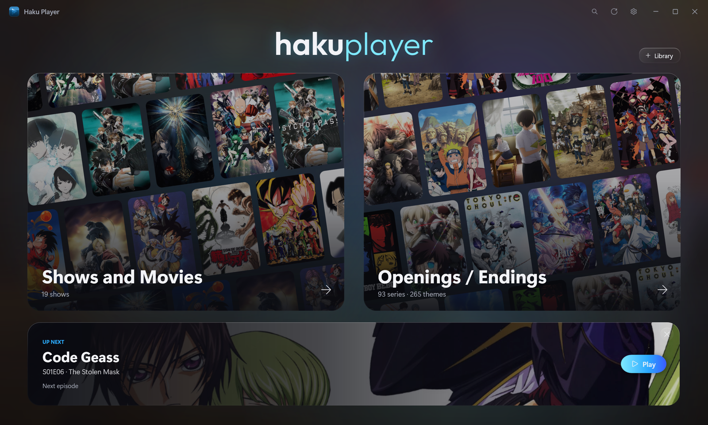

</div>

---

## Core features

### Real-time AI upscaling

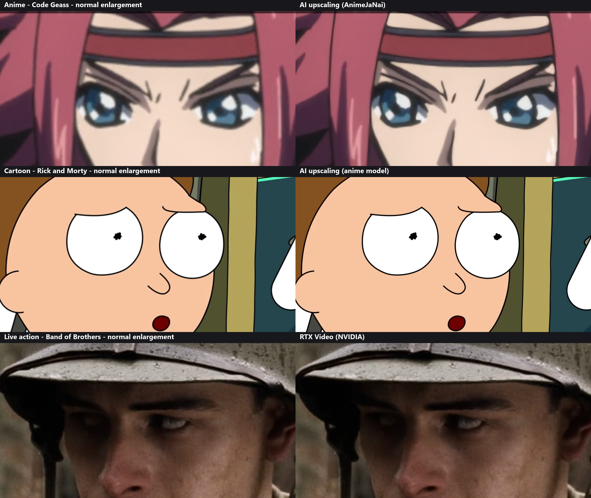

1080p on a 4K screen, zoomed in: the normal enlargement on the left, Haku Player on the right. On an NVIDIA RTX card, anime (Cowboy Bebop) and cartoons (Rick and Morty) are redrawn at twice the size by [AnimeJaNai](https://github.com/the-database/mpv-upscale-2x_animejanai) on TensorRT, live, all on the GPU, a second ahead of playback. Live action (Band of Brothers) uses NVIDIA's RTX Video, which sharpens real footage without the painted look an anime model gives it. Subtitles and controls are drawn afterwards, so they stay sharp.

<table>
  <tr>
    <td width="50%">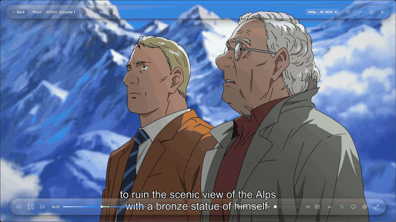</td>
    <td width="50%">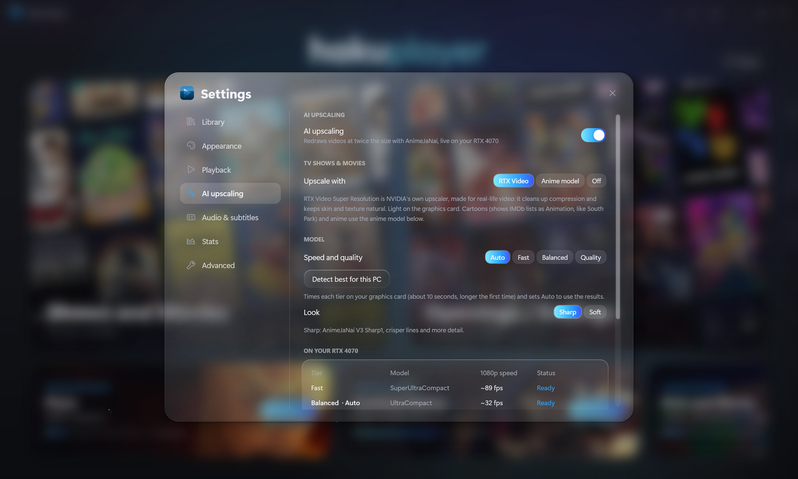</td>
  </tr>
  <tr>
    <td><b>One button</b> · the sparkle button (or <code>Ctrl+U</code>) turns it on or off. A loading panel shows while the AI fills a second of frames, then it plays; the badge shows what it's upscaling to. <i>(Pluto)</i></td>
    <td><b>Its own settings page</b> · Auto, Fast, Balanced or Quality, a sharp or soft look, <i>Detect best for this PC</i>, and what TV shows and movies use. It shows each tier's speed on your card.</td>
  </tr>
</table>

### A liquid-glass player

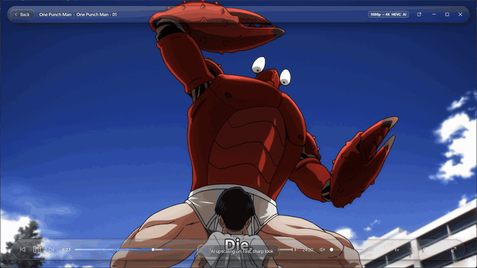

The controls float over the video in two glass pills. A GPU shader blurs, brightens and bends the *moving picture* underneath them every frame, Apple-style, and they fade away after a few seconds. The window itself uses Windows 11's acrylic, with slowly drifting colour glows. <i>(One Punch Man)</i>

### Anime, TV shows and movies in one library

<table>
  <tr>
    <td width="50%">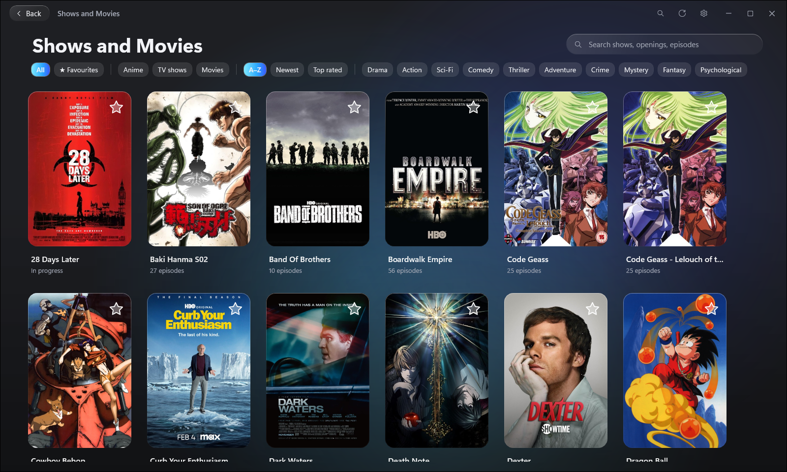</td>
    <td width="50%">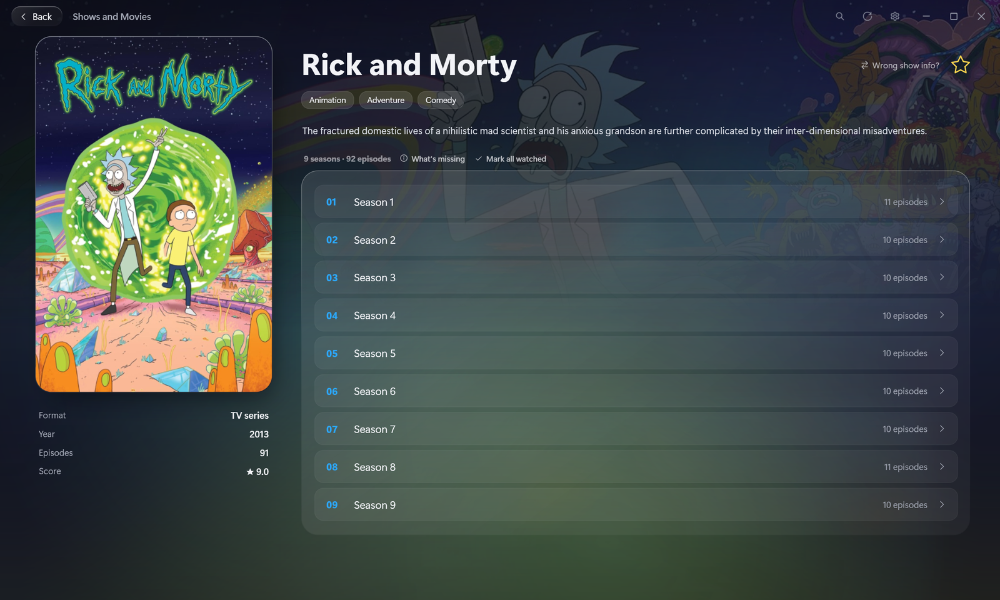</td>
  </tr>
  <tr>
    <td><b>Library</b> · covers, search, favourites, filters by genre or kind, sorting. Badly named folders still find the right show. Openings and endings get a library of their own, named the <a href="https://animethemes.moe">AnimeThemes</a> way.</td>
    <td><b>Show pages</b> · details, banner and official episode names, fetched automatically. Seasons are merged, even from separate folders. Watched ticks, "What's missing" and "Wrong show info?".</td>
  </tr>
</table>

### Skip opening and Up next

<table>
  <tr>
    <td width="50%">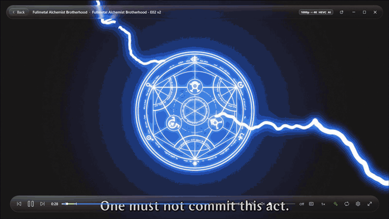</td>
    <td width="50%">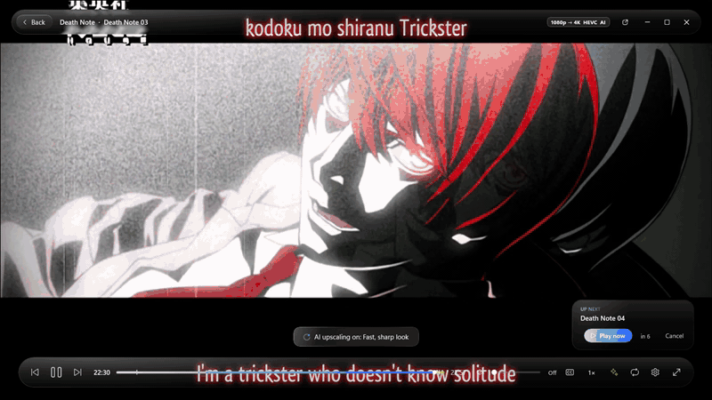</td>
  </tr>
  <tr>
    <td><b>Skip opening / ending</b> · timings from the file's chapters, <a href="https://aniskip.com">AniSkip</a> or <a href="https://theintrodb.org">TheIntroDB</a>; failing that, Haku Player compares the music of two episodes to find them. <i>(Fullmetal Alchemist: Brotherhood)</i></td>
    <td><b>Up next</b> · when the ending starts, the next episode plays after a 10-second countdown, AI and subtitles carrying on. <i>Play now</i> or <i>Cancel</i>. <i>(Death Note)</i></td>
  </tr>
</table>

### Made for anime, good with everything

- Japanese audio and full English subtitles by default for anime (it skips "Signs & Songs" tracks); English for TV and movies. Separate defaults for each.
- Remembers what you've watched: watched ticks, progress bars and the *Continue watching* row on the home screen.
- Plays your original files at full quality through mpv (GPU decoding, no re-encoding) and never renames anything.

## More features

<table>
  <tr>
    <td width="25%">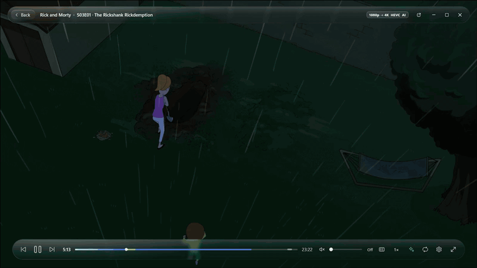</td>
    <td width="25%">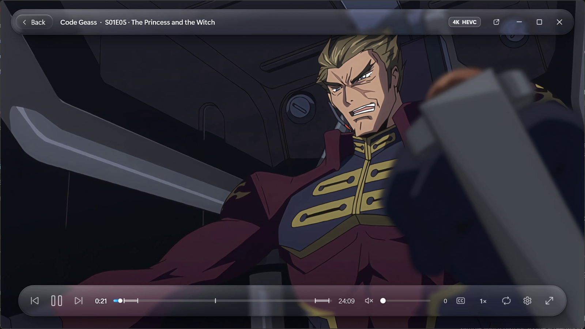</td>
    <td width="25%">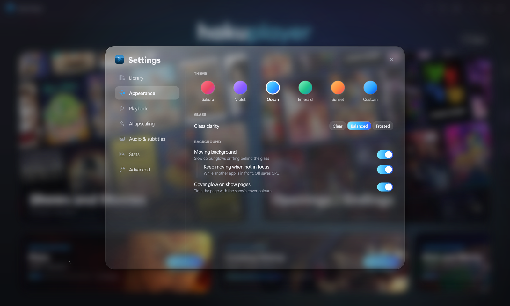</td>
    <td width="25%">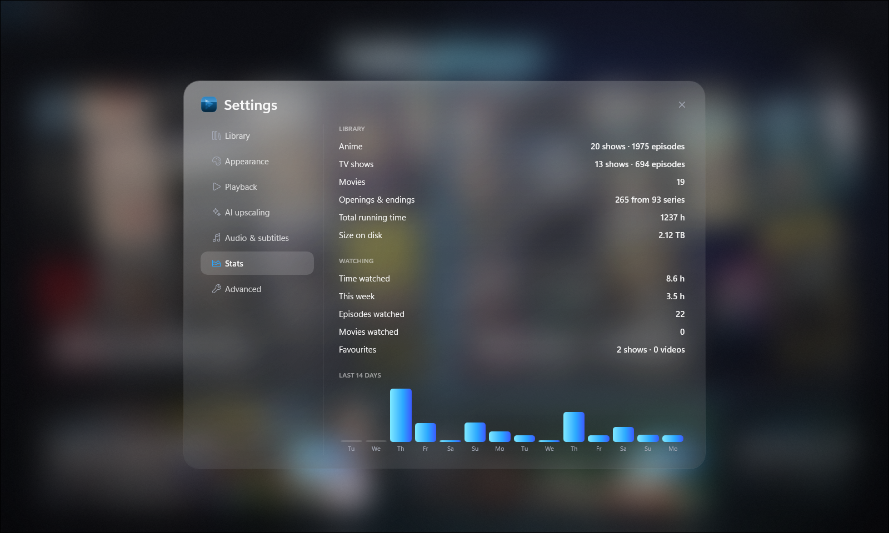</td>
  </tr>
  <tr>
    <td><sub><b>Quick settings</b> · tracks, your own subtitle files, speed, AI tier and look.</sub></td>
    <td><sub><b>The bar</b> · loaded (blue) and AI-ready (green) on the timeline, frame previews on hover.</sub></td>
    <td><sub><b>Themes</b> · five accents or your own colour, glass clarity, motion.</sub></td>
    <td><sub><b>Stats</b> · library size, running time, time watched, a 14-day chart.</sub></td>
  </tr>
</table>

- **Right-click a show** to rename it (in the app only), mark it watched, fix its details or open its folder.
- **Move the subtitles:** drag them up or down on the video.
- **Drop to play:** drag a video or folder onto the window or onto `HakuPlayer.exe`.
- **Pop-out player:** a small always-on-top window in the corner, shaped to the video.
- **Discord status:** "Watching" with the show and time left (optional).
- **Timeline previews:** exact frames, decoded on the GPU and cached.
- **Fill to screen** for near-16:9 screens, exact seeks in under a fifth of a second, and a debug panel.

## All features

<details>
<summary><b>Library</b></summary>

- Several library folders, each marked as anime, TV shows or movies. New files are picked up while the app is open.
- Anime: `Anime Shows` and `Anime Openings` folders. TV: one folder per show *or per season*; seasons of the same show are merged ("Rick.and.Morty.S01…", "Rick and Morty Season 9").
- Details from [AniList](https://anilist.co) for anime and [Cinemeta](https://v3-cinemeta.strem.io) (IMDb) for TV and movies: description, genres, year, studio or director, score, banner and cover.
- Accurate matching: openings named the AnimeThemes way identify their show exactly; otherwise a ranked search (title, year, popularity, format, episode count). Badly named folders still match: it also tries the name cleaned up ("Naruto Complete", "Monster 2004 1080p") and the series name in the episode files ("[CBM]_Monster_-_01_….mkv"). *Wrong show info?* lets you pick the right one.
- Missing covers are downloaded. Anime covers are saved as `cover.jpg` in the show folder; TV and movie covers go in the app's own data folder.
- Official episode names (shown in the app only), a season picker, and *What's missing* (episodes you don't have yet).
- Search across shows, alternative titles and episodes. Favourites, genre and kind filters, sorted A–Z, by newest or by top rated.
- Right-click a show (library card, *Continue watching* card or its page's title): Play or Resume, Rename, Favourite, Mark all watched, *Wrong show info?*, Show in File Explorer. Rename only changes the name in the app; the folder on disk keeps its own.
</details>

<details>
<summary><b>Player</b></summary>

- mpv built into the app (libmpv), drawing straight into the window, with GPU decoding and the `high-quality` profile. Resumes where you left off (openings and endings always start from the top).
- Live liquid-glass controls (a GLSL shader on mpv's output). They hide after 2, 3 or 5 seconds, together with the cursor.
- Timeline: exact-frame hover previews, chapter ticks, opening and ending marked. Previews decode outward from where you hover, on the GPU (CUDA) with a CPU fallback, and are cached.
- Skip opening, ending and recap (optionally automatic), an Up next countdown and Autoplay.
- Audio and subtitle menu that prefers full subtitles over signs-only. Add your own subtitle files and shift their timing; both are remembered per video.
- Drag the subtitles up or down on the video to put them where you like (the cursor shows when you're over them); the spot is kept for every video, and *Position* in the menu puts them back.
- Speed, volume (wheel works anywhere), fill-to-screen for near-16:9 screens, fullscreen, and a pop-out player that stays on top. Exact seeks land in under a fifth of a second, even with AI upscaling on.
- The window keeps the video's shape when you resize it. Keyboard shortcuts are mpv's (space, arrows, `f`, `m`, `j`, `z`/`x`…).
- Debug panel: codec, colour, decoder, frame rate, dropped frames, A/V sync and bitrate.
</details>

<details id="ai-upscaling">
<summary><b>AI upscaling</b></summary>

- Real-time 2× AI upscaling with [AnimeJaNai](https://github.com/the-database/mpv-upscale-2x_animejanai) V3 models on NVIDIA TensorRT, in a filter built into Haku's own libmpv. Every frame stays on the GPU, and subtitles, controls and the glass are drawn after it, at full resolution.
- Tiers: **Fast**, **Balanced** and **Quality** (on an RTX 4070 at 1080p: about 85, 31 and 17 fps), plus **Auto**, which picks the best one that keeps up with each video's size and frame rate. A **sharp** or **soft** look.
- *Detect best for this PC* times each tier on your card, and Auto then uses the measured speeds.
- Two anime models to choose from: **AnimeJaNai** (above) or [**Adore**](https://github.com/renarchi/Re-SISR/releases/tag/Adore) by renarchi, made for 1080p anime, with crisper, darker line art. Adore runs at about 26 fps on an RTX 4070 at 1080p, between Balanced and Quality. When it can't keep up with a video, Auto drops to AnimeJaNai's faster tiers for that video. It's downloaded (3 MB) from renarchi's release the first time you pick it, and kept only if it's exactly that file.
- A second of frames upscaled ahead of playback, shown in green on the timeline. Starting a video, turning AI on and clicking the timeline wait a moment for it to fill, with a loading panel. Turning AI on while paused shows the AI picture straight away.
- If a tier can't keep up with a video, Auto steps down to a faster one for that video; it only turns off if the fastest can't keep up either.
- Any video up to 2560×1728 (1080p, 1440×1080 4:3, 720p, SD), 8- or 10-bit. 4K files and HDR play as they are.
- **TV shows and movies** use NVIDIA's **RTX Video Super Resolution**, made for live action and light on the GPU, sized to fill your screen. Cartoons in those libraries (IMDb's *Animation* genre, like South Park or Rick and Morty) use the anime model. You can choose RTX Video, the anime model or off.
- The sparkle button glows green while upscaling, and its tooltip says what it's doing and how many frames are ready.
</details>

<details>
<summary><b>Watching</b></summary>

- An episode counts as watched once you reach its ending (or 90% of the way in). Tick or untick by hand, per episode, season or show.
- *Continue watching* row on the home screen: every show you're part-way through, or onto the next episode of. Close a card to hide it until you next watch that show.
- Stats: library size and running time, time watched (total and this week), a 14-day chart and most-watched shows.
- Discord status, *"Watching Haku Player · Cowboy Bebop · S01E05"* with time left. Optional, and needs your own Discord application ID.
</details>

## Requirements

| | |
|---|---|
| **Windows** | Windows 11 (22H2 or later, for the acrylic backdrop) |
| **.NET** | [.NET 9 Desktop Runtime](https://dotnet.microsoft.com/download/dotnet/9.0) (or the SDK to build) |
| **libmpv** | To build: put `libmpv-2.dll` in `lib\` (see below). It's copied next to the exe, so nothing else to install |
| **FFmpeg** | `winget install Gyan.FFmpeg` (`ffmpeg` / `ffprobe` on `PATH`), for previews, opening/ending detection and stats |
| **GPU** | Any. NVIDIA cards decode timeline previews with CUDA; others fall back to the CPU |
| **AI upscaling** (optional) | An NVIDIA RTX card; Haku's own `libmpv-2.dll` (with its `vf_hakusr` filter) and `haku_sr.dll`, built into `lib\` and copied next to the exe; and the TensorRT runtime and models in `%LOCALAPPDATA%\Haku Upscaler`. How to build them: [native/README.md](native/README.md). Without them the option just stays off |

## Getting started

```powershell
git clone https://github.com/nbkburns-git/haku-player.git
cd haku-player
# libmpv (too big for the repo): from a shinchiro "mpv-dev-x86_64" build, https://github.com/shinchiro/mpv-winbuild-cmake/releases
# extract libmpv-2.dll into lib\
dotnet build -c Release
.\bin\Release\net9.0-windows\HakuPlayer.exe
```

For a faster-starting build (ReadyToRun):

```powershell
dotnet publish -c Release -r win-x64 --self-contained false -p:PublishReadyToRun=true -o publish
```

Then open **Settings → Library → Add library** and choose your folders.

### Expected folder layout

```text
Anime library\                 ← marked "Anime"
├─ Anime Shows\
│  └─ Cowboy Bebop\
│     ├─ cover.png              (optional; downloaded if missing)
│     └─ Season 1\S01E01 - Asteroid Blues.mkv
└─ Anime Openings\
   └─ Cowboy Bebop\
      └─ CowboyBebop-OP1.webm     (AnimeThemes names: Show-OP1, Show-ED2…)

TV Shows\                      ← marked "TV shows"
├─ The Sopranos (1999)\S01E01 - Pilot.mkv
└─ Rick.and.Morty.S02.1080p…\  (season folders of one show are merged)

Movies\                        ← marked "Movies"
├─ Spirited Away (2001)\Spirited Away.mkv
└─ Akira (1988).mkv
```

Everything Haku Player stores (settings, watch history, fetched details, covers, preview cache) lives in
`%LOCALAPPDATA%\Haku Player`. Your media folders are only ever read, except for a downloaded anime `cover.jpg`.

## Tests

```powershell
powershell -ExecutionPolicy Bypass -File tests\native-tests.ps1   # haku_sr.dll: colours, padded edges, speed per tier
powershell -ExecutionPolicy Bypass -File tests\app-tests.ps1      # the app, end to end (a few minutes, muted)
```

The app tests build a test copy with its own data folder (your settings and history aren't touched) and drive it through
mpv's pipe and UI Automation: the AI start-up buffer, exact seeks, pausing, the AI button, turning it on while paused, a
10-bit 30 fps video (no frame drops, no green edge), a 4K file, subtitle choice, the next episode, your own subtitle files,
RTX Video on a live-action show and the anime model on a cartoon, the Adore model (its first download and preparation, switching model and tier while playing, leftover settings, the settings page), leaving the player mid-start, openings from a file's chapters, show-detail matching (and re-checking older matches), renaming a show, the
window staying on its monitor, and no UI stalls or "not responding" anywhere. Put your own test videos in
`tests\media.local.ps1` (git-ignored; the keys are listed in `tests\app-tests.ps1`). Test windows can go on another
monitor and never take focus: set `$TestWindow = "x,y,w,h"` there, in screen pixels.

## How it works

The short version: mpv runs inside the app as a library and draws each frame into a Direct3D texture that WPF shows like any other image, so the video, the controls and the window resize as one picture. The app drives mpv over its JSON IPC pipe, and the blur under the controls is a shader running inside mpv.
[**docs/how-it-works.md**](docs/how-it-works.md) has the details: the glass shader, why fades are drawn by one renderer only, how openings are detected from audio fingerprints, and more.
AI upscaling is an mpv video filter (`vf_hakusr`) that hands D3D11 decoder frames to TensorRT and back without leaving the GPU, on its own thread, a second ahead: [**docs/realtime-upscaling-plan.md**](docs/realtime-upscaling-plan.md) and [**native/README.md**](native/README.md).

## Privacy

There's no telemetry and no account. Haku Player only goes online to fetch details and timings:
AniList, AnimeThemes, Cinemeta, IMDb's poster lookup, AniSkip, TheIntroDB and IntroDB. Picking the Adore model downloads it once from GitHub. Discord status, when you
turn it on, talks to the Discord app on your own PC.

## Credits

- [mpv](https://mpv.io) and [libplacebo](https://code.videolan.org/videolan/libplacebo) for playback and the shader hook; [FFmpeg](https://ffmpeg.org) and Chromaprint for previews and fingerprints.
- [AniList](https://anilist.co), [AnimeThemes](https://animethemes.moe), [Cinemeta](https://v3-cinemeta.strem.io), [AniSkip](https://aniskip.com), [TheIntroDB](https://theintrodb.org) and [IntroDB](https://introdb.app) for their free APIs.
- AI upscaling: [AnimeJaNai](https://github.com/the-database/mpv-upscale-2x_animejanai) models by the-database and [Adore](https://github.com/renarchi/Re-SISR) by renarchi (both CC BY-NC-SA 4.0, not included), run with [NVIDIA TensorRT](https://developer.nvidia.com/tensorrt).
- [Outfit](https://github.com/Outfitio/Outfit-Fonts) by The Outfit Project Authors, under the [SIL Open Font License](Assets/Fonts/OFL-Outfit.txt).
- Artwork in the screenshots belongs to its owners. The screenshots show the author's own library.

Haku Player plays files you already have; it doesn't include, find or download any videos.

## License

[MIT](LICENSE) © 2026 Thomas Burns
