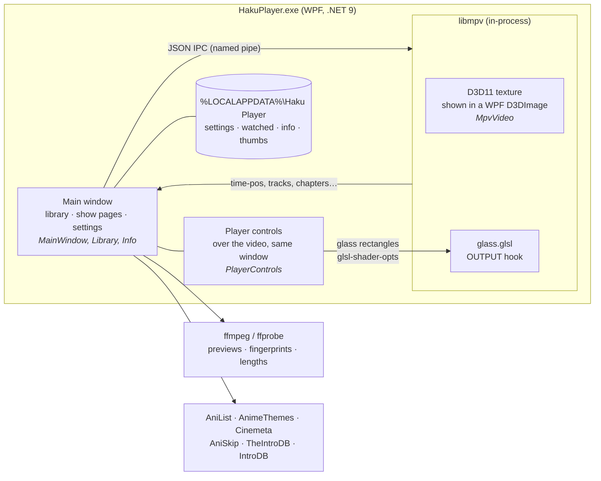

# How Haku Player works

A tour of the parts that took the most figuring out. File names point at the source.

## Embedding mpv

mpv runs inside the app as a library (`lib\libmpv-2.dll`, `MpvVideo.cs`). It draws each frame with libmpv's Direct3D 11
render API into a texture that's shared with a Direct3D 9 surface, which WPF shows in a `D3DImage`. The video is just
another element in the window: the controls sit on top of it in the same window, and a resize redraws the current frame
at the new size in the same layout pass, so the picture, the bars and the window always move together.

The app still drives mpv over its JSON IPC pipe (`\\.\pipe\animeplayer-<pid>-<n>`, a new one for each video). It watches
the properties it needs (`time-pos`, `pause`, `track-list`, `chapter-list`, `video-params/aspect`…) and sends commands back.
Keys are forwarded with `keypress`, so mpv's own shortcuts work. A click on the video pauses, a double-click goes
fullscreen, and the cursor hides with the controls.

Launching the exe with a video (dragging one onto it) plays it straight away. If the app is already open, the new
launch hands the path to that window over a named pipe and quits (`App.xaml.cs`), so you never get a second window.

## The liquid glass

The glass over the video is two layers:

1. **WPF** draws the tint, which adapts to how bright the scene is, plus the sheen, the specular rims and the shadow (`GlassSurface.cs`).
2. **mpv** blurs the actual moving picture underneath (`Assets/glass.glsl`). An `OUTPUT` hook takes up to four rounded rectangles: the bottom pill, the top bar, a menu, and the Skip/Up next card. Inside each one it applies a 48-tap golden-angle blur, a saturation and brightness lift, and a lens-like bend near the edge.

The app tells the shader where the rectangles are with `glsl-shader-opts`, in the picture's own coordinates. That way 4:3 video with side bars still lines up.

The libmpv render API uses mpv's own renderer, not libplacebo's, which limits shader params. It takes only plain `float` params (no `DYNAMIC`) and at most 16 per shader. So each param carries two numbers, packed as one whole number below 2^24 (`PlayerControls.Pack`, unpacked in the shader). Each rectangle uses three params: `_p` (x, y), `_s` (w, h) and `_r` (radius, alpha). A hidden one sends zeros. The values are uniforms, so moving the bars doesn't recompile anything: it costs about 0.5 ms a frame while they move.

Until 2026-11-08 the shader still used the libplacebo-only form, and mpv silently refused to load it ("Unrecognized PARAM TYPE"). The `glass` test in `tests\app-tests.ps1` checks that mpv loads it.

`gpq = 1` is for HDR output (PQ / BT.2020, see `docs/winui3-migration-plan.md`). The shader then works on SDR-like values, so the glass looks the same as in SDR. Haku's WPF window is SDR only and leaves it at 0.

### Why fades are drawn by one renderer

mpv shows a shader change about 0.1 s after it's sent:

- it renders each frame ahead of time (`video-timing-offset`, 0.05 s);
- it keeps a short queue of frames (`swapchain-depth`, 2);
- it only redraws when a new video frame is due, about every 42 ms at 24 fps.

WPF draws on the next display refresh. The gap changes with load, so no amount of timing keeps the two layers in step. Fading both together left a "ghost bar": the blur lingering after the bar had gone.

So during a fade-out, WPF draws the **whole** bar by itself from a blurred snapshot of the current frame, and mpv's blur is switched off at the start, hidden underneath until it catches up (`GlassHandoff.cs`). Bars fading back in use the live blur straight away, so you never see an old picture. Updates to mpv also go out one at a time: the next is only sent once mpv confirms the last, which stops them piling up in a queue.

### Pop-ups and tooltips

Pop-ups such as *What's missing* and tooltips share one glass panel (`GlassPanel` in `App.xaml`). Just before one opens,
the app copies the bit of screen behind it and blurs that (`GlassFrost.cs`), a few milliseconds' work. Rendering the page
itself for the blur took around 300 ms and made every tooltip stutter.

## Timeline previews

`Thumbs.cs` runs ffmpeg in the background (CUDA decode and scale when available), producing one exact frame per second.
`-skip_frame:v noref` skips frames nothing depends on, about 45% less decoding for a frame or two of accuracy. Decoding starts **where you hover** and fills outwards, forwards first and then backwards in blocks. The frames are kept as JPEGs in one cache file per video.

## Openings and endings

`Segments.cs` tries three sources, best first:

1. **The file's chapters.** Titles such as `Opening`, `OP`, `Ending`, `Credits`, `Recap` or `オープニング` are recognised.
2. **Online.** [AniSkip](https://aniskip.com) for anime, looked up by MyAnimeList id (taken from AniList) and episode number. For TV and movies, [TheIntroDB](https://theintrodb.org) v4, then [IntroDB](https://introdb.app), looked up by IMDb id, season and episode. Nothing found is checked again after a week.
3. **Audio fingerprints.** The same method as Jellyfin's Intro Skipper. ffmpeg's Chromaprint muxer fingerprints the first ~7 minutes and the last ~5 minutes of this episode and of its neighbour in the same season (one value per 0.124 s). The app then slides one fingerprint across the other, looking for the longest run where values differ by at most 6 of 32 bits, allowing gaps of up to 3.5 s. A run of 15–240 s at the start is the opening; one at the end is the ending. On Code Geass this matched AniSkip's community times to within about a second. The files are read one at a time, because reading several places at once is slower on a hard disk.

An episode counts as watched once playback reaches its ending (otherwise at 90%). Up next shows when the ending starts and counts down 10 seconds of playback, so pausing pauses it. The countdown starts when the card appears and restarts after a seek, so jumping deep into the ending still gives you time to choose.

## Matching shows

Anime details come from AniList's GraphQL API. Openings named the AnimeThemes way (`KimetsuNoYaiba-OP1…`) are looked up on AnimeThemes, which knows each theme's exact AniList entry. Otherwise a search is ranked by:

- exact title, then nickname;
- format (TV series beats a short or an OVA);
- log popularity;
- whether the episode count fits.

A nickname match on an obscure short can't beat the famous series. TV and movies use Cinemeta (keyless IMDb metadata), plus IMDb's own poster where Cinemeta's art is wrong.

## Performance notes

- **Startup:** covers decode in parallel at card size, and the whole library scan takes about 0.2 s for ~1,000 files.
- **Animations:** the drifting cover walls are cached one bitmap per row, so animating them only moves textures. The colour glows are cached at quarter resolution and run at 30 fps. Both pause while hidden, minimised or scrolling.
- **Player overlay:** the timeline only redraws while it's visible. Glass positions are only worked out while something can move.
