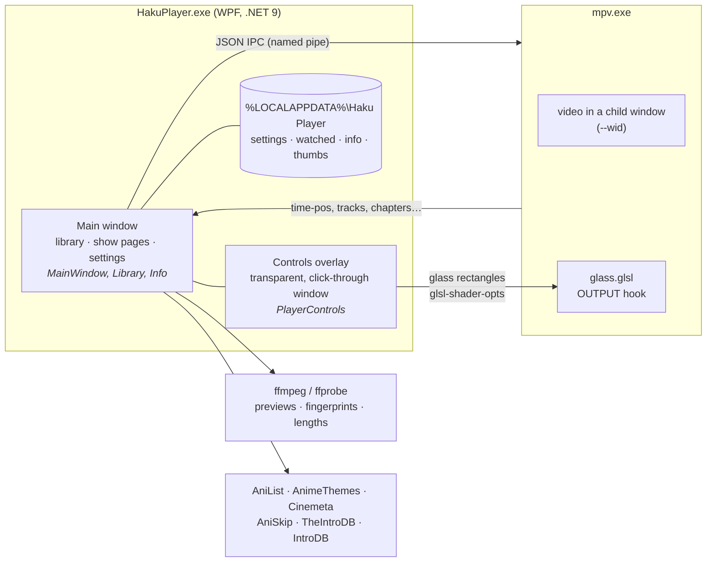

# How Haku Player works

A tour of the parts that took the most figuring out. File names point at the source.

## Embedding mpv

mpv renders into a WinForms panel inside the WPF window (`--wid`) and is driven over its JSON IPC pipe
(`\\.\pipe\animeplayer-<pid>-<n>`, a new one for each video). The app watches the properties it needs
(`time-pos`, `pause`, `track-list`, `chapter-list`, `video-params/aspect`…) and sends commands back.

Two Windows details needed workarounds:

- **Keyboard.** Focus never reaches mpv's window, because it belongs to another process. So while a video plays, the app forwards keys over IPC (`keypress`). Printable characters arrive through WPF's text input, so they match your keyboard layout.
- **Mouse.** mpv passes the mouse through to the panel underneath, so the panel does the work: moving shows the controls, a click pauses, a double-click goes fullscreen, and it hides the cursor. Resizing from the window edges over the video uses the native hit-test codes.

## The liquid glass

WPF can't draw on top of another process's window, so the controls live in their own **transparent, owned window** over the video. Its fully transparent pixels let clicks through to the video, and it never takes focus, so keys keep going to the main window.

The glass itself is two layers:

1. **WPF** draws the tint, which adapts to how bright the scene is, plus the sheen, the specular rims and the shadow (`GlassSurface.cs`).
2. **mpv** blurs the actual moving picture underneath (`Assets/glass.glsl`). A libplacebo `OUTPUT` hook takes up to four rounded rectangles: the bottom pill, the top bar, a menu, and the Skip/Up next card. Inside each one it applies a 48-tap golden-angle blur, a saturation and brightness lift, and a lens-like bend near the edge.

The app tells the shader where the rectangles are with `glsl-shader-opts`, in the picture's own coordinates. That way 4:3 video with side bars still lines up. A `//!WHEN` condition switches the whole pass off while every rectangle is invisible.

### Why fades are drawn by one renderer

mpv shows a shader change about 0.1 s after it's sent:

- it renders each frame ahead of time (`video-timing-offset`, 0.05 s);
- it keeps a short queue of frames (`swapchain-depth`, 2);
- it only redraws when a new video frame is due, about every 42 ms at 24 fps.

WPF draws on the next display refresh. The gap changes with load, so no amount of timing keeps the two layers in step. Fading both together left a "ghost bar": the blur lingering after the bar had gone.

So during a fade-out, WPF draws the **whole** bar by itself from a blurred snapshot of the current frame, and mpv's blur is switched off at the start, hidden underneath until it catches up (`GlassHandoff.cs`). Bars fading back in use the live blur straight away, so you never see an old picture. Updates to mpv also go out one at a time: the next is only sent once mpv confirms the last, which stops them piling up in a queue.

## Timeline previews

`Thumbs.cs` runs ffmpeg in the background (CUDA decode and scale when available), producing one exact frame per second.
`-skip_frame:v noref` skips frames nothing depends on, about 45% less decoding for a frame or two of accuracy. Decoding starts **where you hover** and fills outwards, forwards first and then backwards in blocks. The frames are kept as JPEGs in one cache file per video.

## Openings and endings

`Segments.cs` tries three sources, best first:

1. **The file's chapters.** Titles such as `Opening`, `OP`, `Ending`, `Credits`, `Recap` or `オープニング` are recognised.
2. **Online.** [AniSkip](https://aniskip.com) for anime, looked up by MyAnimeList id (taken from AniList) and episode number. For TV and movies, [TheIntroDB](https://theintrodb.org) v4, then [IntroDB](https://introdb.app), looked up by IMDb id, season and episode. Nothing found is checked again after a week.
3. **Audio fingerprints.** The same method as Jellyfin's Intro Skipper. ffmpeg's Chromaprint muxer fingerprints the first ~7 minutes and the last ~5 minutes of this episode and of its neighbour in the same season (one value per 0.124 s). The app then slides one fingerprint across the other, looking for the longest run where values differ by at most 6 of 32 bits, allowing gaps of up to 3.5 s. A run of 15–240 s at the start is the opening; one at the end is the ending. On Code Geass this matched AniSkip's community times to within about a second. The files are read one at a time, because reading several places at once is slower on a hard disk.

An episode counts as watched once playback reaches its ending (otherwise at 90%). Up next starts its 10-second countdown when the ending starts, counting playback time, so pausing pauses it.

## Matching shows

Anime details come from AniList's GraphQL API. Openings named the AnimeThemes way (`KimetsuNoYaiba-OP1…`) are looked up on AnimeThemes, which knows each theme's exact AniList entry. Otherwise a search is ranked by:

- exact title, then nickname;
- format (TV series beats a short or an OVA);
- log popularity;
- whether the episode count fits.

A nickname match on an obscure short can't beat the famous series. TV and movies use Cinemeta (keyless IMDb metadata), plus IMDb's own poster where Cinemeta's art is wrong.

## Performance notes

- **Startup:** covers decode in parallel at card size, and the whole library scan takes about 0.2 s for ~1,000 files.
- **Animations:** the drifting cover walls are cached one bitmap per row, so animating them only moves textures. The colour glows are cached at quarter resolution and run at 30 fps. Both pause while hidden, minimised or scrolling.
- **Player overlay:** the timeline only redraws while it's visible. Glass positions are only worked out while something can move.
